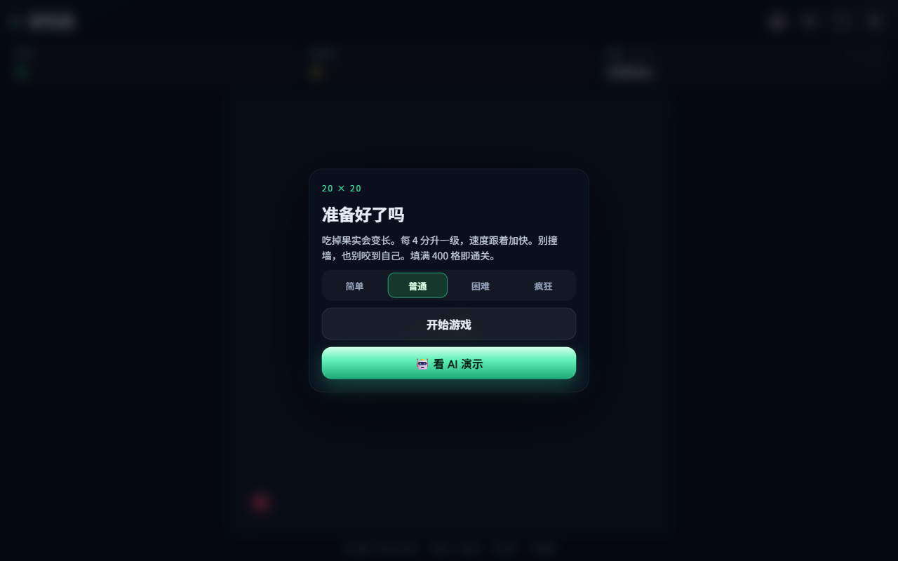
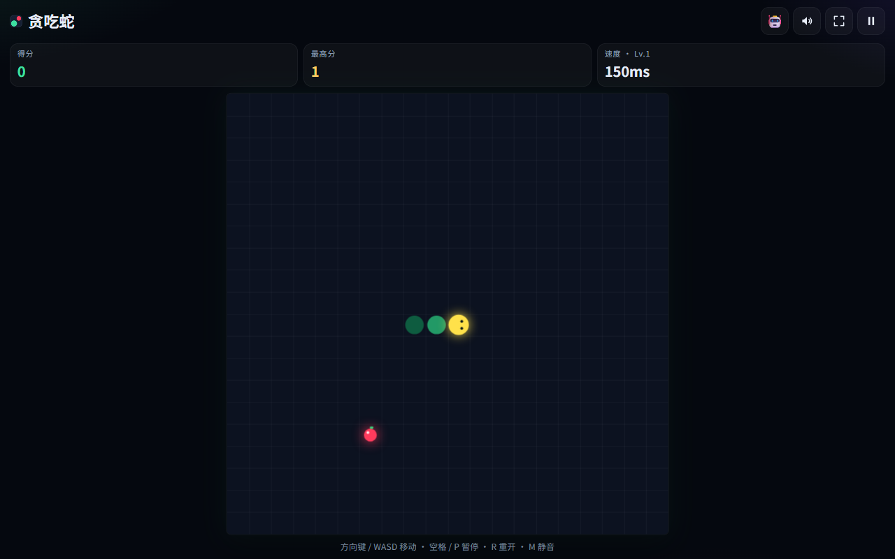
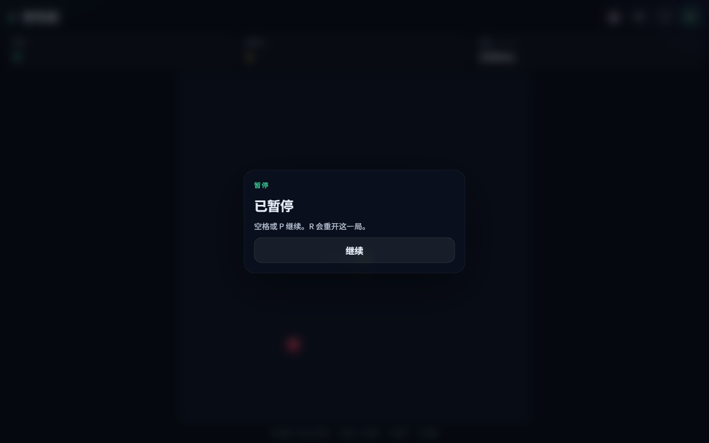
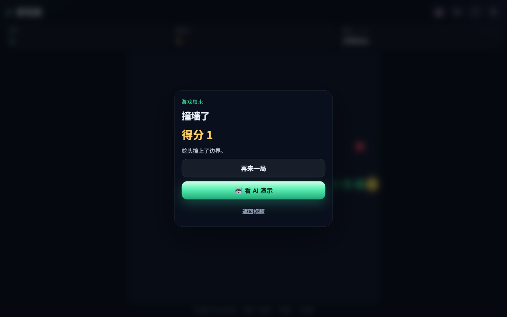
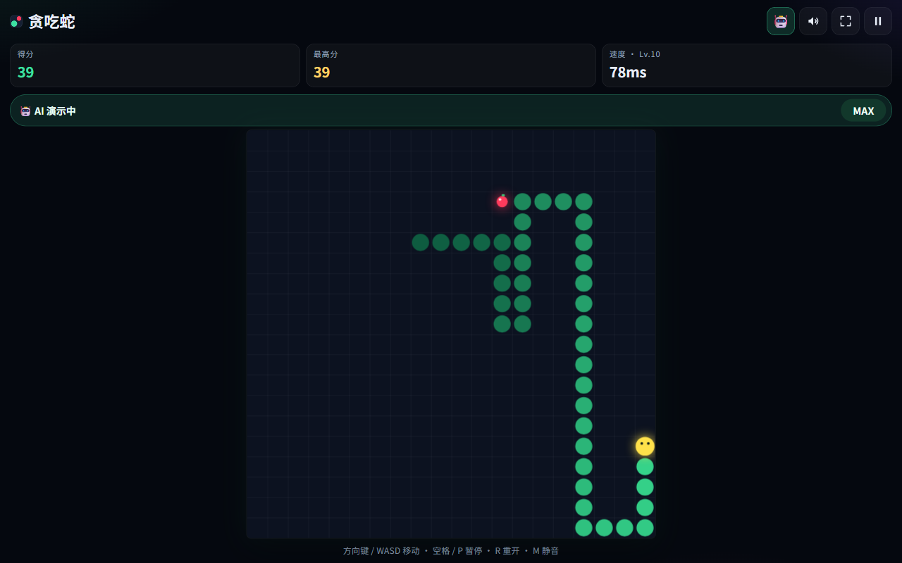
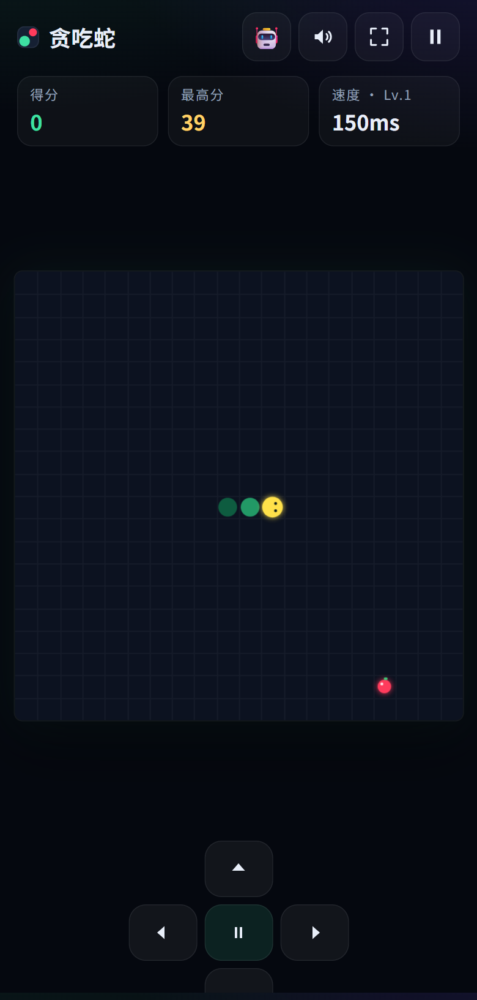

# 贪吃蛇

20×20 的贪吃蛇，纯原生 HTML / CSS / JS，没有构建步骤。双击 `index.html` 就能玩，也可以丢到任意静态目录或 GitHub Pages 子路径。

## 界面

开始界面可以选择四档难度，也可以直接看 AI 演示。



对局时，蛇头、果实和当前速度都在棋盘上。最高分会在吃到果实的当下写入。



空格或 P 暂停。窗口失焦时也会自动暂停。



撞墙或咬到自己会结束这一局，可以重开，也可以改看 AI。



AI 演示可以在 ×1、×4、×16、×64 和 MAX 之间切换。



MAX 大约 20–30 秒填满棋盘。通关时会写明用了 397 个果实。


手机竖屏用屏幕方向键，中间一键暂停。横屏矮屏会收起方向键，改为在棋盘上滑动。



## 怎么玩

- 方向键或 WASD 转向。转向会先排进队列（最多 2 次），不能 180° 掉头。
- 鼠标按住拖动，或在棋盘上滑动，位移超过阈值就转向。
- 触屏底部有方向键，正中间是暂停。横屏矮屏会收起方向键，改为滑动。
- 空格或 P 暂停，R 随时重开，结束后 Enter 再开一局，M 静音。
- 切到后台或窗口失焦会自动暂停。
- 吃到果实 +1 分并变长。每 4 分升 1 级，最高 10 级，速度随等级加快。
- 撞墙或咬到自己结束。身体铺满 400 格则通关（开局 3 节，需要 397 个果实）。
- 最高分写在 `localStorage`（`snake.best`）。破纪录的那一下立刻落盘，不必等到游戏结束。中途按 R 重开也不会清掉最高分。

难度只改速度（毫秒/步，1 级 → 10 级），选择会记住：

| 难度 | 速度 |
| --- | --- |
| 简单 | 230 → 150 |
| 普通 | 150 → 78 |
| 困难 | 105 → 58 |
| 疯狂 | 70 → 38 |

## AI 演示

开始、结束、通关面板上都有「🤖 看 AI 演示」。右上角的 🤖 也可以中途接手。

AI 走一条预先算好的 20×20 哈密顿环：第 0 列向下，其余列蛇形往返，第 0 行向左闭合。头只落到环上「头 → 尾」之间的空格，因此不会撞到自己；再按食物远近抄近路。空地小于蛇长的 1.25 倍时禁止跳格，没有合法步就退回不门控，避免卡死。沿环最终会经过每一个果实，所以能填满棋盘。

演示条上的速度会在 ×1、×4、×16、×64、MAX 之间循环。MAX 大约 20–30 秒通关。演示时忽略玩家的方向输入，暂停、继续、全屏仍然有效。AI 的分数同样计入最高分。

## 安装到桌面

用 Chrome 或 Edge 通过 http(s) 打开（本地静态服务器或 GitHub Pages），地址栏会出现安装图标，也可以在菜单里选择「安装贪吃蛇」。装好后以独立窗口打开，主题色 `#05080f`。

`file://` 双击可以玩，但浏览器不允许在文件协议下注册 Service Worker，所以安装和离线缓存需要放到网站上。

手机浏览器使用「添加到主屏幕」。页面适配安全区；320px 宽不会把棋盘挤出屏幕。

## 离线与更新

Service Worker 对导航和静态资源都是网络优先，失败再用缓存。激活时会删掉旧缓存名。

页面引用 `style.css?v=1`、`ai.js?v=1`、`game.js?v=1`，和 `sw.js` 里的预缓存列表一致。注册使用 `updateViaCache: 'none'`，并会主动 `update()`。已经有旧 Worker 时，新 Worker 接管后会自动刷新一次。

发新版时同时改资源上的 `?v=` 和 `sw.js` 里的 `CACHE` 名字。

## 文件

| 文件 | 作用 |
| --- | --- |
| `index.html` / `style.css` / `game.js` | 页面、操作、渲染、音效 |
| `ai.js` | 哈密顿环 AI，浏览器里是 `window.SnakeAI`，Node 里可 `require` |
| `manifest.webmanifest` / `sw.js` | 安装与离线 |
| `icons/` | 192、512、maskable 图标 |
| `tools/` | 模拟、对照分析、浏览器验收、图标生成 |

## 验证

AI 模拟不需要额外依赖：

```bash
node tools/simulate-ai.cjs
node tools/analyze-ai.cjs
```

`simulate-ai.cjs` 用和游戏相同的规则，跑 4 档难度 × 5 个种子，断言全部吃满 397 个果实。`analyze-ai.cjs` 对比纯绕环、本策略和曼哈顿下界，并按前 25% / 中段 50% / 后 25% 统计每果实步数。

图标用 Pillow 重新生成（可重复执行）：

```bash
pip install pillow
python3 tools/make_icons.py
```

浏览器验收需要 Playwright（只给验证脚本用，游戏本身零依赖）。下面把包装在临时目录，避免写进仓库：

```bash
npm install --prefix /tmp/pw playwright
npx --prefix /tmp/pw playwright install chromium
NODE_PATH=/tmp/pw/node_modules node tools/verify.cjs
NODE_PATH=/tmp/pw/node_modules node tools/verify-sw-update.cjs
```

`verify.cjs` 用 `file://` 打开页面，覆盖 1280×820、390×844、844×390、320×568。它读取 canvas 像素认出蛇头和果实，自己走键盘把蛇喂到升级，并检查暂停、R 重开、最高分、标题、有没有滚动条，以及 AI 在浏览器里打到 397 分。

`verify-sw-update.cjs` 起一个本地静态服务，把旧的 `index.html`、`style.css`、`game.js` 写进 Cache Storage，刷新后必须仍然跑到新代码；然后再断网刷新，确认缓存兜底。
